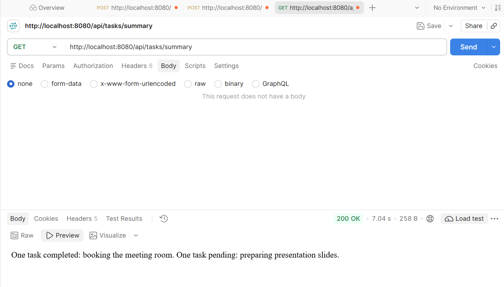
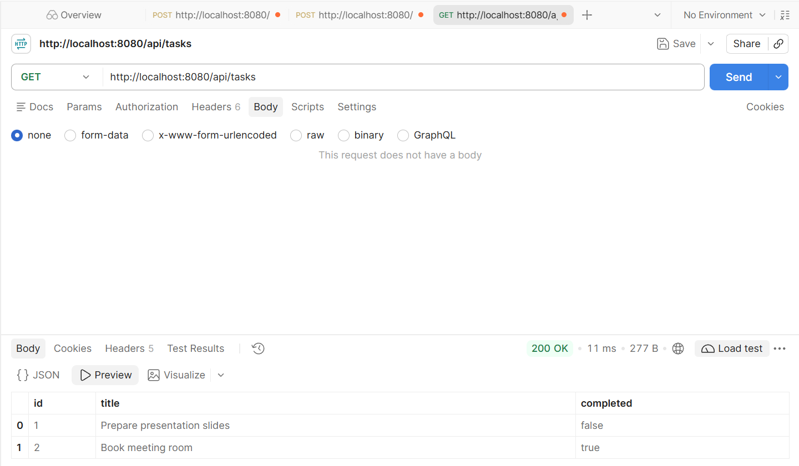

# Structured-output verification

The Task 6 service maps AI-generated JSON into TaskSummaryResult using Spring AI's `.entity(TaskSummaryResult.class)`. The controller returns the POJO's summary field as text/plain through GET `/api/tasks/summary`.

## Live provider verification

An interactive Postman run on 24 October 2026 verified the POJO implementation at commit `bb7e686`. The application ran in WSL Ubuntu with Java 21.0.12.1, Spring Boot 4.1.2, Spring AI 2.0.1, and OpenRouter configured through environment variables with the `openrouter/free` model route.

The application started on port 8080. GET `/api/tasks` returned 200 OK with an empty list. Two POST requests then returned 201 Created and saved these task records:

| ID | Title | completed |
| --- | --- | --- |
| 1 | Prepare presentation slides | false |
| 2 | Book meeting room | true |

GET `/api/tasks/summary` returned **200 OK** in **7.04 seconds** with this response body:

> One task completed: booking the meeting room. One task pending: preparing presentation slides.

TaskSummaryService maps the nonempty task-list response into TaskSummaryResult, validates the summary field, and returns the POJO. TaskSummaryController reads `getSummary()` to produce the plain-English response above.

A subsequent GET `/api/tasks` returned **200 OK** with both original records unchanged, including their IDs, titles, and completion states.

## Build result

The Java 21.0.13 Temurin / Maven 3.10.0 `clean verify` build completed successfully on 24 October 2026 at 11:34:57 Singapore time. All 28 tests passed with zero failures, errors, or skips. The executable Jar was packaged successfully.

| Suite | Tests passed |
| --- | --- |
| Task service | 10 |
| Application context | 1 |
| Task controller HTTP integration | 3 |
| Summary service | 7 |
| Summary HTTP integration | 7 |
| Total | 28 |

The [Maven result summary](structured-output/maven-verify-summary.txt) records the suite counts and build result. The [summary-service report](structured-output/sg.edu.ntu.taskflowapi.service.TaskSummaryServiceTest.txt) and [summary HTTP report](structured-output/sg.edu.ntu.taskflowapi.controller.TaskSummaryHttpTest.txt) record the updated conversion tests.

## Conversion and HTTP behaviour

Service tests pass controlled JSON through the actual ChatClient conversion into TaskSummaryResult and verify trimmed summary text. They also verify task IDs, titles, completion states, completed/pending counts, and literal braces in task titles.

HTTP integration tests run Spring Boot on a random port and connect the Spring AI HTTP client to a local OpenAI-compatible server. The server returns a chat-completion envelope whose content contains the structured JSON. The tests verify that GET `/api/tasks/summary` returns HTTP 200, Content-Type text/plain, and the summary sentence extracted from the POJO. The provider request includes schema instructions, and stored task records retain their saved values.

Malformed JSON, null results, absent/null/blank summary fields, blank provider output, and failed provider requests return 502. Provider diagnostics are excluded from the HTTP response. Empty task lists return the factual empty-list message without a provider request, and lists above fifty tasks return 413.

The [earlier interactive OpenRouter screenshots](task6-verification.md#live-provider-verification) record the text-response implementation at commit `158a381`. The live verification above and the 28-test build cover the POJO implementation. The public endpoint keeps the same plain-English response format.

## Source

- [TaskSummaryResult.java](../../src/main/java/sg/edu/ntu/taskflowapi/model/TaskSummaryResult.java)
- [TaskSummaryService.java](../../src/main/java/sg/edu/ntu/taskflowapi/service/TaskSummaryService.java)
- [TaskSummaryController.java](../../src/main/java/sg/edu/ntu/taskflowapi/controller/TaskSummaryController.java)
- [Spring AI structured outputs](https://docs.spring.io/spring-ai/reference/api/structured-output.html)
