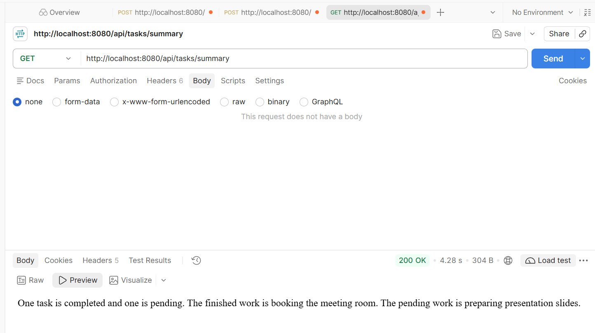
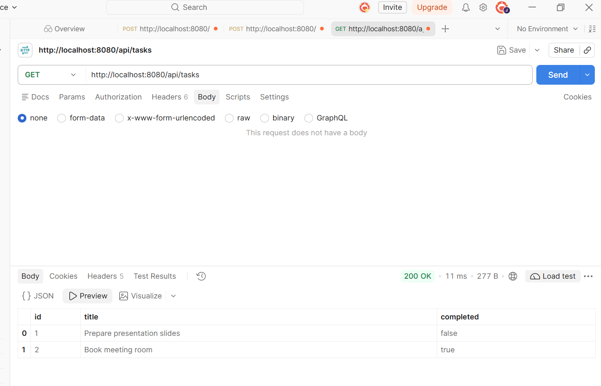

# Task 6 summary verification

Automated tests and interactive Postman verification: 24 October 2026, Singapore time. Newman collection run: 23 October 2026, Singapore time.

The reports below record the text-response implementation, including the live run of commit `158a381`. [Structured-output verification](structured-output-verification.md) records the subsequent TaskSummaryResult POJO conversion tests.

## Live provider verification

The application ran in WSL Ubuntu with Java 21.0.12.1, Spring Boot 4.1.2, Spring AI 2.0.1, and an OpenRouter connection configured through environment variables.

| Item | Recorded result |
| --- | --- |
| Provider | OpenRouter |
| Configured model route | `openrouter/free` |
| Request | GET `http://localhost:8080/api/tasks/summary` |
| HTTP status | 200 OK |
| Observed response time | 4.28 seconds |
| Summary | Three sentences describing one completed task and one pending task |

The two synthetic task records were:

| ID | Title | completed |
| --- | --- | --- |
| 1 | Prepare presentation slides | false |
| 2 | Book meeting room | true |

The returned response body was:

> One task is completed and one is pending. The finished work is booking the meeting room. The pending work is preparing presentation slides.

A subsequent GET `/api/tasks` returned 200 OK and retained both records with their original IDs, titles, and completion states.

The [WSL Ubuntu build result](verification.md#wsl-ubuntu-build-and-interactive-verification) records the successful 24-test Maven build for the explicit-lambda changes in commit `158a381`.

## Test design

TaskSummaryServiceTest uses controlled model doubles to inspect prompt data and exercise service behaviour. TaskSummaryHttpTest runs the application on a random local port and connects the actual Spring AI HTTP client to an in-process OpenAI-compatible test server.

The HTTP server supplies controlled responses at `/v1/chat/completions`. This design makes request serialization, response parsing, and error cases repeatable.

## Executed checks

| Area | Case | Result |
| --- | --- | --- |
| Prompt data | Task IDs, titles, states, completed count, and pending count | Passed |
| Literal titles | Braces in titles remain task data | Passed |
| Successful response | GET /api/tasks/summary returns 200 and text/plain | Passed |
| Stored state | Summary leaves task records unchanged | Passed |
| Empty task list | 200 with a factual empty-list message | Passed |
| Size limit | More than fifty tasks returns 413 | Passed |
| Provider error | Provider failure becomes readable 502 | Passed |
| Blank output | Empty provider content becomes readable 502 | Passed |
| Error details | HTTP response excludes provider diagnostics | Passed |

Five summary-service tests and five summary HTTP tests passed. The complete Maven build, including the task-controller HTTP suite, passed 24 tests with zero failures, errors, or skips.

## Postman collection run through Newman

The nine-request AI collection ran against the packaged application with the local test server. All fifteen assertions passed. The collection created two synthetic tasks, requested a summary, completed the pending task, requested another summary, deleted both records, and checked the empty-list response.

The captured provider requests contained completed/pending counts of 1/1 followed by 2/0. The [saved summary report](task6-postman-summary.json) contains the request data and explicitly labelled simulated response text.

## Reports

| Report | Contents |
| --- | --- |
| [Summary service tests](sg.edu.ntu.taskflowapi.service.TaskSummaryServiceTest.txt) | Five service-test results |
| [Summary HTTP tests](sg.edu.ntu.taskflowapi.controller.TaskSummaryHttpTest.txt) | Five integration-test results |
| [Maven build](java-http-maven-verify.txt) | Complete 24-test build and packaging output |
| [AI collection run](task6-ai-newman.txt) | Nine requests and fifteen assertions |
| [Provider-contract data](task6-postman-summary.json) | Captured task data and controlled responses |
| [CRUD regression](task6-crud-newman.txt) | Twenty-four requests and thirty-eight assertions |

Provider configuration and interactive Postman procedures are documented in the [Task 6 guide](../task6-ai-summary.md).
